<picture>
  <source media="(prefers-color-scheme: dark)" srcset="./assets/header-dark.svg">
  
</picture>

I study mathematics and finance at Northeastern University (minor in data science, class of 2027) and do quantitative research on volatility, regime detection, and derivatives pricing.

Most of what's here is built from first principles. I write the base model by hand, check it against a case with a known answer, extend it one step at a time, and only then calibrate it to real data and turn it into something usable.

## Now

- **Quantitative Researcher, [Northeastern University Systematic Alpha](https://github.com/NU-Systematic-Alpha).** Pricing options around earnings announcements: replicating Dubinsky, Johannes, Kaeck & Seeger (*RFS*, 2019) and extending their earnings-jump model to stochastic (Heston) and local (Dupire) volatility.
- **Teaching assistant, Differential Equations** at Northeastern.
- **Building** a multivariate volatility framework (DCC-GARCH, GO-GARCH, Bayesian stochastic volatility) and a Bayesian changepoint study (HSMM, reversible-jump MCMC, Markov-switching VAR).

## Selected work

| Project | What it does | Methods |
|---|---|---|
| [**derimo**](https://github.com/vij-akshat/derimo) | A derivative pricing, modelling, and risk library across three asset classes. Install it with `pip install derimo`. | Stochastic calculus |
| [**Delta hedging P&L**](https://github.com/vij-akshat/delta-hedging-pnl) | Delta hedging from first principles: gamma–theta P&L, the 1/√N replication law, cost-aware rebalancing, and model risk when prices jump or volatility is stochastic. | Black–Scholes Greeks, jump and stochastic-vol models |
| [**VWAP and market impact**](https://github.com/vij-akshat/vwap-market-impact) | Optimal execution from first principles: benchmarking against VWAP, decomposing market impact, and tracing the cost–risk frontier. | Almgren–Chriss, impact models |
| [**Market regime detection**](https://github.com/vij-akshat/market-regime-detection) | Identifies distinct market states from sector ETF returns, with a [live app](https://market-regime-detection-6hisenpwzndtox2duxlqe9.streamlit.app). | Singular value decomposition |
| [**Portfolio optimizer**](https://github.com/vij-akshat/portfolio-optimizer) | Mean-variance optimization from the Markowitz frontier to real constraints: position limits, sector caps, and turnover, with a [live app](https://portfolio-optimizer-lne53yq74g458zxupuarcy.streamlit.app). | Convex optimization (CVXPY) |
| [**Cardinality-constrained portfolios**](https://github.com/vij-akshat/Cardinality-Constrained-Portfolio-Optimization) | Mean-variance optimization with a cap on the number of assets held, which turns a convex problem into a combinatorial one. | Integer programming |
| [**Implied volatility surface**](https://github.com/vij-akshat/volitality-surface) | Builds implied volatility surfaces from live options data, with a [live app](https://volatility-surface.streamlit.app). | Black–Scholes, Brent root-finding |

<b>Model library</b>: the base models the projects above are built on

 

Each one is derived, implemented from scratch, and tested on market data in [model-executions](https://github.com/vij-akshat/model-executions), then reused as a building block.

| Area | Models |
|---|---|
| Regimes and breaks | Hidden Markov model, CUSUM, SADF bubble tests |
| Filtering and signals | Kalman filter, wavelets |
| Volatility and memory | Volatility estimators, Yang–Zhang volatility, Hurst exponent |
| Information and complexity | Entropy, Lempel–Ziv complexity |
| Simulation | Monte Carlo methods |
| Allocation | Ikigaii, an asset-allocation engine for Indian equities on the NSE |

## Tools and contact

Python (NumPy, pandas, PyTorch, TensorFlow, CVXPY, Streamlit), SQL (MySQL, MongoDB), Docker, Flask, Git, and LaTeX.

Reach me on [LinkedIn](https://linkedin.com/in/akshat-vij) or by [email](mailto:akshatvij99@gmail.com).
